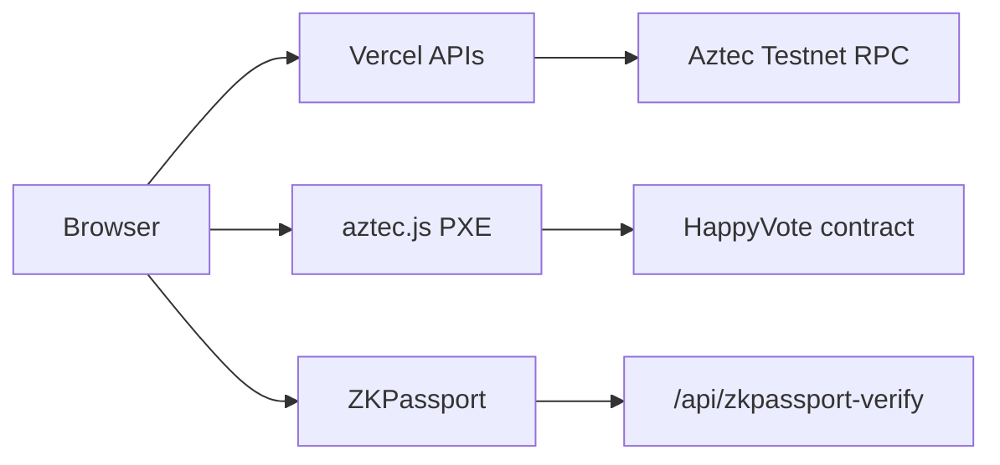

# HappyVote on Aztec

Private-by-default voting on [Aztec Network](https://aztec.network). Stable **6.0.0** is on Testnet and Mainnet. This site votes on Testnet.

**Live:** https://aztec.happyvote.xyz  
**Docs:** [English](./docs/en/README.md) · [Русский](./docs/ru/README.md)

Cast a **private or open** ballot. An unsealed tally stays public. A sealed option is a private note until the tally recipient publishes the counts. Important polls can require [ZKPassport](https://zkpassport.id/) personhood without sending passport data to HappyVote.

## What this repo contains

| Path | Contents |
|------|----------|
| `src/main.nr` | `HappyVote` Aztec.nr contract (multi-poll) |
| `hidden_author_book/` | Private-author note contract |
| `sealed_tally_book/` | Private sealed-option notes |
| `author_fee_sponsor/` | Mainnet fee payer for a private author. Not deployed |
| `src/test/` | Noir tests |
| `scripts/` | Contract deploy helpers |
| `web/` | Vite + React UI and Vercel serverless APIs |
| `docs/en` · `docs/ru` | Product, architecture (Mermaid), privacy, user guide |

Related EVM HappyVote is a **separate** product. This repository is Aztec-only.

Compile and test with the **`aztec` CLI** (not `nargo` or `bb` directly). Official setup: https://docs.aztec.network/developers/getting_started

## Testnet

HappyVote: [`0x256692c1a2f24fe72c4351db82a72d0591225c132886c190d03a0069151f9f78`](https://testnet.aztecscan.xyz/address/0x256692c1a2f24fe72c4351db82a72d0591225c132886c190d03a0069151f9f78)  
HiddenAuthorBook: [`0x0db4e58ff03bd09d758c4e3aee0fb042b21e61aa410aad2f6a0b8f7537fefeec`](https://testnet.aztecscan.xyz/address/0x0db4e58ff03bd09d758c4e3aee0fb042b21e61aa410aad2f6a0b8f7537fefeec)  
SealedTallyBook: [`0x11b4482fff1547eed30cb860cd9e017e1b84890539641ab3831d9c98b35d3b3d`](https://testnet.aztecscan.xyz/address/0x11b4482fff1547eed30cb860cd9e017e1b84890539641ab3831d9c98b35d3b3d)  
RPC: `https://aztec-testnet.drpc.org`  
Sponsored FPC: `0x2d8fff82a3b0c15d0a89169e7d8d043e079ab94d52031f1de1e4972ebad169d3`  
Details: [docs/en/10-TESTNET-ADDRESSES.md](./docs/en/10-TESTNET-ADDRESSES.md)

A public author is stored on the poll. A private author is a Poseidon2 commitment. The hidden-author book holds that secret, and the Sponsored FPC pays that create and early end. `AuthorFeeSponsor` is the Mainnet payer and is not deployed. A sealed option stays in `SealedTallyBook` until the tally recipient publishes the counts. Earlier networks keeps Testnet 5.1.0 [`0x2e10858cf6750c003489a62f570535966fb940bb10d18a0c146a36cac64713b6`](https://testnet.aztecscan.xyz/address/0x2e10858cf6750c003489a62f570535966fb940bb10d18a0c146a36cac64713b6) and the earlier Testnet 6.0.0 contract [`0x20053869edad8edf92f0b7144bfc6344e0534866f26b0f330cee87431ebd9e14`](https://testnet.aztecscan.xyz/address/0x20053869edad8edf92f0b7144bfc6344e0534866f26b0f330cee87431ebd9e14). Those rows do not open `/p/:id`.

## Architecture (short)

Private vote: `SingleUseClaim` nullifier → public tally increment (address stays hidden). A sealed ballot records the option as a private note and increments the public count only after publish.  
See [docs/en/02-ARCHITECTURE.md](./docs/en/02-ARCHITECTURE.md).

## License

MIT (HappyVote). Some files originate from [aztec-starter](https://github.com/AztecProtocol/aztec-starter) (Apache-2.0).

## Author

Peter Ploskikh — [X](https://x.com/pittpv) · [LinkedIn](https://www.linkedin.com/in/peter-ploskikh/) · [GitHub](https://github.com/pittpv/)
