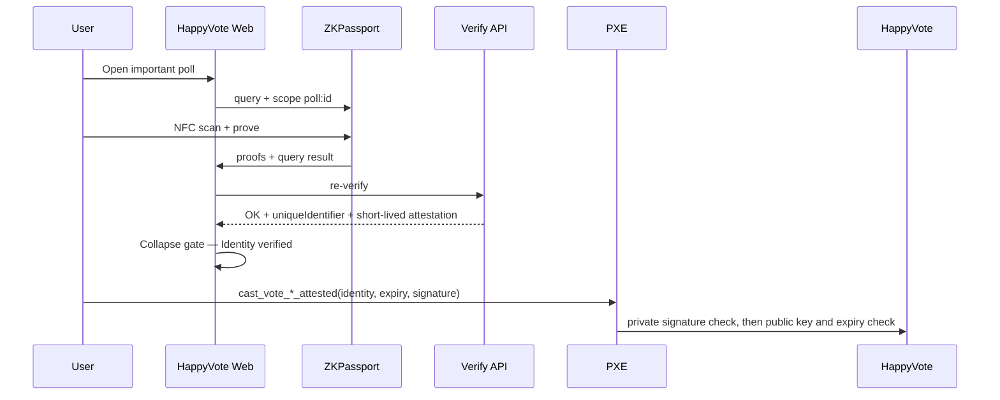

# 04 — ZKPassport

Official: https://zkpassport.id/ · Docs: https://docs.zkpassport.id/  
Domain: `aztec.happyvote.xyz`

## 1. Why

For important polls:

- person vs bot / account farm;
- optional age / nationality / sanctions;
- **no** passport files on HappyVote servers.

Flow: NFC ID → proof on phone → HappyVote gets predicates result + `uniqueIdentifier`.

Open-eligibility polls do **not** use ZKPassport. They only bind one vote per Aztec account, so a new Browser session can add another ballot.

## 2. Integration modes

| Mode | When | Query source |
|------|------|----------------|
| Self-served SDK | Per-poll rules | `@zkpassport/sdk` / `@zkpassport/ui` |
| Dashboard policy | Stable branded flow | [dashboard.zkpassport.id](https://dashboard.zkpassport.id) |

Production: SDK + QR (`ZKPassportQRCode`), domain registered, default Dashboard policy id `vote-identity-verification` (RU elections template) when `policyId` is set for important polls.

When catalog `policyId` is set, the widget query is Dashboard-locked (`.policy(id)` only) and the request scope is that policy id. Self-served polls use `poll:{id}`. Self-served predicates in catalog JSON are not sent with a policy. The server calls `verify()` with the same scope, and for a policy it uses the Dashboard query rather than the query posted by the browser. The All polls **country** filter still needs those countries: if catalog `countries` / `nationalityIn` / `issuedBy` are empty, the UI loads the public Dashboard project for `aztec.happyvote.xyz` and uses `nationality` and `issuing_country` (`eq` / `in`). The live catalog `policyId` is what the widget uses; on-chain `metadata_hash` is set at `create_poll` and does not change if the catalog id is later replaced.

### Creator settings

A poll created on **Create** does not set a Dashboard policy id. Personhood is required. Optional checks, stored with the signed listing:

| Check | Bound |
|-------|--------|
| Age | Integer 1–99. Minimum is `age.gte`, maximum is `age.lte`. |
| Birthdate and document expiry | Calendar day `YYYY-MM-DD`, committed as that UTC day |
| Nationality and issuing country | ISO alpha-3, include (`in`) or exclude (`out`). One code cannot be both |
| Document type | One of passport, national ID, residence permit |
| Sanctions, FaceMatch | Sanctions list, or FaceMatch `strict` |

A poll that names a Dashboard policy id proves that policy. Age, country, and document rows on the listing are not the request. The scope is the policy id.

### Voter check

The QR request is built from the listing. After the phone proves, `onSuccess` posts the proofs, the query result, the original query, and the scope to `/api/zkpassport-verify`. For a self-served poll the server accepts that query only when every stored rule is present. A tighter query is accepted. A missing or wider check is rejected. `verify()` checks the proofs against that query and scope. The ballot uses the `uniqueIdentifier` from that response.

For a policy poll the server loads the current Dashboard query for the catalog policy id and passes that query to `verify()` with the same scope. The query posted by the browser is not the one that is verified.

## 3. Query examples

Personhood only:

```tsx
<ZKPassportQRCode
  name="HappyVote on Aztec"
  purpose="Prove you are a unique person to vote"
  scope={`poll:${pollId}`}
  query={(q) => q.done()}
  onSuccess={async ({ proofs, result }) => {
    // POST proofs, result, originalQuery, and scope to /api/zkpassport-verify.
    // The server calls verify() and returns uniqueIdentifier.
  }}
/>
```

Gated example: `q.gte("age", 18).eq("nationality", "RUS")` — only fields the poll needs.

## 4. Bind to the Aztec vote



On-chain: `identity_commitment ≠ 0` for eligibility 1/2; `identity_claims` rejects reuse. The vote uses the identity field from the attestation. The signature covers poll, identity, period, and expiry. It is valid for about 15 minutes. A later vote needs a new scan.

## 5. Domain rules

1. Register `aztec.happyvote.xyz` in the ZKPassport Dashboard.
2. `uniqueIdentifier` is scoped to the domain and the request scope (`poll:{id}`, or the policy id when a Dashboard policy is set). Changing the domain or that scope changes IDs. A policy request's scope is the policy id, so personhood ids for those polls differ from builds that omitted the scope.
3. Do not log proofs with PII.

## 6. Proofs

Keep server re-verify enabled. Mock passports are for local development only; production polls should use real ID proofs.

## 7. Product limits

- Several IDs per person → “one ID ↔ one vote”, not perfect uniqueness.
- Stronger personhood: FaceMatch `strict` + salted unique identifier (ZKPassport docs).
- FaceMatch on iOS uses Apple App Attest inside the ZKPassport app. A DeviceCheck / key-attestation error is on that app and Apple, not HappyVote.
- User needs the ZKPassport app.

## 8. When to require it

| Poll type | Default eligibility |
|-----------|---------------------|
| Fun / Happy/Sad | Open |
| Community governance | Personhood recommended |
| Political / “election-style” | Personhood required (+ optional gates) |
| User-created (iter 2) | Creator chooses; platform may force above a threshold |

## 9. Off-chain requirements JSON

Stored in catalog / `localStorage`. At `create_poll`, SHA-256 of canonical JSON is reduced into a Field → on-chain `metadata_hash` (browser digest bytes go through a Node `Buffer` before `fromBufferReduce`). The hash is `PublicImmutable`. A later catalog `policyId` change updates the widget query, not that on-chain field.

```json
{
  "personhood": true,
  "minAge": 18,
  "nationalityIn": ["USA", "DEU"],
  "nationalityOut": [],
  "sanctions": false,
  "facematchStrict": false,
  "policyId": null,
  "purpose": "Prove eligibility to vote on HappyVote on Aztec"
}
```

`eligibility_mode`: `1` personhood-only · `2` if age / birthdate / nationality / document / sanctions / FaceMatch / `policyId` is set. Age outside 1–99 is rejected before the poll is published.

## 10. UI (2026-09-18)

The QR widget is drop-in `@zkpassport/ui`. HappyVote wraps it in portal chrome (teal / amber / Sora). SDK `display` hides the duplicate widget title.

`--zkp-bg` on the card must stay an **opaque** ink color: the widget paints **Try again** (and Open in app) with that variable. Transparent `--zkp-bg` made the retry label invisible after a failed scan.

After success:

- QR is removed (bridge no longer needed);
- compact **Identity verified** banner;
- details (checks + personhood id, and Dashboard policy predicates when `policyId` is set) expand on click.

## 11. Checklist

- [x] `@zkpassport/sdk` + `@zkpassport/ui` (`VITE_ZKPASSPORT_ENABLED=true`)
- [x] Domain in Dashboard
- [x] Gate + requirement list
- [x] Per-poll ZKPassport requirements at create
- [x] On-chain `eligibility_mode` + `metadata_hash`
- [x] `/api/zkpassport-verify`
- [x] `identity_commitment` + `identity_claims`
- [x] Portal-styled gate + collapse on success
- [x] Catalog country filter from Dashboard policy `nationality` / `issuing_country`
- [x] Noir: same identity, two accounts fails
- [ ] Real-device E2E on Testnet
