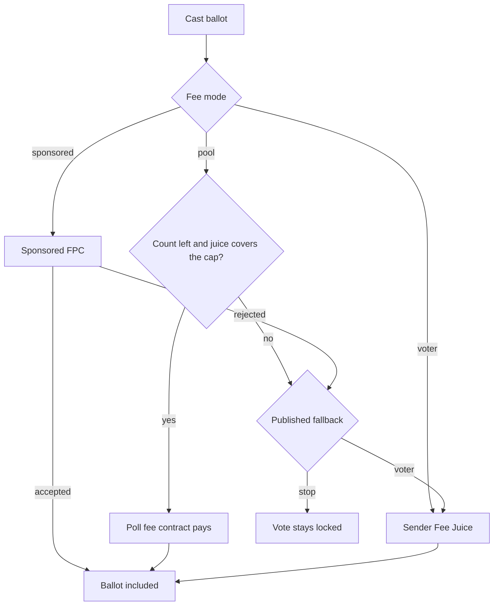

# 05 — Development Plan

Toolchain: **Aztec Testnet 6.0.0**. Alpha is **6.0.0**.  
AI / CLI: https://docs.aztec.network/developers/ai_tooling

## Phase 0 — Foundation

**Status: done (2026-08-11)**

Node 24.12, Aztec CLI 5.1.0, docs, `AGENTS.md`, bootstrap from aztec-starter.

**Exit:** `aztec compile` and `aztec test` green (48/48).

## Phase 1 — Core voting contracts

**Status: done** — Noir tests + local smoke

- Multi-poll `HappyVote` storage
- `cast_vote_private` / `cast_vote_open` + shared `SingleUseClaim`
- Public tally update + open ballots
- `create_poll` / `end_poll` / `cancel_poll` / `transfer_admin` / `set_paused` (contract admin)
- On-chain `starts_at` / `ends_at`; `next_poll_id`
- Truncation checks on `option_id` (private + public)

## Phase 2 — Frontend MVP

**Status: done** — https://aztec.happyvote.xyz

- Vite React app in `web/`
- Connect Aztec account (Browser session = initializerless in-page PXE; also Demo Wallet / extension)
- Poll page with privacy toggle
- Guest tallies via `/api/poll-state`
- Fraunces / Sora, teal / amber
- Responsive vote layout (1080px)

## Phase 3 — Testnet

**Status: deployed 2026-08-12**, current contract 2026-08-14  
Addresses: [10-TESTNET-ADDRESSES.md](./10-TESTNET-ADDRESSES.md)

Remaining: manual private/open vote from an external account on production.

## Phase 4 — ZKPassport

**Status: live**

SDK + QR gate + server re-verify + on-chain `identity_commitment`. Domain `aztec.happyvote.xyz`. Default policy `vote-identity-verification`. Remaining: real-device E2E.

## Phase 5 — Product hardening

**Status: hardening for Iteration 1 (2026-08-14)**

| # | Task | Status |
|---|------|--------|
| 5.1 | Sealed tally | Done — on-chain `sealed` + UI hide until `end_poll` |
| 5.2 | Metadata + catalog | Done — `GET/POST /api/polls` (seed + Vercel Blob) |
| 5.3 | Legal pages | Done — Terms, Privacy, Data Safety, Cookies, GDPR |
| 5.4 | Security review | Done — option_id truncation; XSS/boot; ZKPassport mock gated to DEV |
| 5.5 | Client error ingest | Done — `POST /api/client-error` |
| 5.6 | Performance | Vote page: one `/api/poll-state` read, contract registration once per connected address, one pre-prove simulation inside `send`. CRS CSP and IndexedDB PXE unchanged |
| 5.7 | Production frontend | Done — CSP, APIs, SEO |
| 5.8 | Mobile vote CTA + option bars | Done |
| 5.9 | ZKPassport portal chrome | Done — collapse after success |
| 5.10 | Catalog voting window | Done — on-chain `starts_at` / `ends_at` + catalog ISO + UI countdown |
| 5.11 | Contract hardening | Done — PublicImmutable config, private checks before nullifier, pause, cancel, transfer_admin, next_poll_id |
| 5.12 | First-party visit stats | Done — cookieless `POST /api/site-stats`, operator `GET` |
| 5.13 | Initializerless Browser session | Done — `createSchnorrInitializerlessAccount`; no account-deploy tx |

## Phase 6 — Mainnet image

**Status: network image live (2026-10-30).** Stable Aztec **6.0.0** is the image on Testnet and on Mainnet (Alpha).

| Network | RPC |
|---------|-----|
| Testnet | `https://aztec-testnet.drpc.org` |
| Mainnet | `https://aztec-mainnet.drpc.org` |

HappyVote at https://aztec.happyvote.xyz still casts ballots on **Testnet**. Putting this contract on Mainnet is separate work: Fee Juice or an FPC, a new contract address, and a persistent wallet as the default connect path once that wallet speaks 6.0.0. Browser session can stay as optional onboarding. The Labs Demo Wallet stays off the connect list.

## Iteration 2 — user-created polls

**Status: not started.** Iteration 1 stays operator-published. This is the implementation plan.

### Outcome

A connected Aztec account can publish a poll. Voters find it on All polls. The contract still enforces one ballot per account (or per UTC day) and a public tally, or a sealed tally until close. The homepage stays a curated list.

### What exists

`create_poll` is admin-only. It stores option count, privacy policy, eligibility, `metadata_hash`, the sealed flag, the schedule, and vote frequency. Titles and option labels live in the catalog and are bound by that hash. `end_poll`, `cancel_poll`, and pause stay with the contract admin. `MAX_OPTIONS` is 32. A poll needs at least two options.

### Contract

Add a public entry any account can call. Keep admin `create_poll` for the polls HappyVote already publishes.

The new entry fails closed:

- The caller is stored as that poll’s creator.
- `options_count` is from 2 through 32.
- Privacy and eligibility stay within the enums the contract already accepts.
- `metadata_hash` is non-zero.
- `ends_at` is required, is in the future, and is at most 90 days after `starts_at` (or after the block time when `starts_at` is 0).
- The contract is not paused.
- The poll id is allocated from `next_poll_id`. The caller does not choose an id, so an existing poll cannot be overwritten.
- One create nullifier per account per UTC day, and at most three still-open polls from that creator.
- The creator may call `end_poll` on their own poll. `cancel_poll` and pause stay admin-only.

Noir tests: non-admin create, reject overwrite, reject a missing end, reject create while paused, reject a fourth open poll, creator can end, a stranger cannot end, admin cancel still works.

### Catalog

The chain does not store titles. After the create transaction is included, the creator publishes labels to the catalog with a signature from the same address that sent the transaction. The server checks that signature and checks that `metadata_hash` matches the canonical JSON of the title, description, and option labels. A missing signature or a mismatched hash is not listed.

The creator cannot set homepage flags. A new poll is listed on All polls only.

### Anti-spam

- The on-chain daily create cap and the open-poll cap above.
- The catalog rejects an empty title, a label longer than 80 characters, a description longer than 280 characters, and more than eight topics.
- On Testnet, the first poll create per account per UTC day may use the Sponsored FPC. Further creates that day pay the creator’s Fee Juice. On Mainnet, creating a poll always pays the creator’s Fee Juice.
- No listing when the hash or the signature does not match.

### Ballot fees

A vote is one Aztec transaction: `cast_vote_private` or `cast_vote_open`, plus the fee-payment call. HappyVote does not add a second charge in that transaction. The poll stores the fee mode and the fallback when it is created. Neither changes later without a new poll.

| Mode | Who pays the network fee | Where it is offered |
|------|--------------------------|---------------------|
| `sponsored` | Aztec’s public Sponsored FPC, `sponsor_unconditionally` | Testnet only. Mainnet create rejects this mode. |
| `voter` | Fee Juice of the account that sends the ballot | Testnet and Mainnet. Mainnet default. |
| `pool` | A fee-payment contract bound to that poll, while a public remaining count is above zero and the contract’s Fee Juice covers the fee cap | Testnet and Mainnet. Optional. |

The fallback is chosen at create and shown on the poll before anyone votes: `stop` locks Vote, or `voter` lets later ballots use the sender’s Fee Juice. A rejected sponsorship does not switch mode by itself.

The fee cap stays the rule already used on Testnet: `maxFeesPerGas` is twice the latest block, so a long prove does not lose a base-fee race. The fee-payment contract is not put in `additionalScopes`. `sponsor_unconditionally` only names the payer. It does not read that contract’s private notes.

**Testnet.** The default for a new poll is `sponsored`, the same public Sponsored FPC as today’s ballots (`0x2d8fff82a3b0c15d0a89169e7d8d043e079ab94d52031f1de1e4972ebad169d3`). The page says the network fee is sponsored. If that FPC rejects the transaction, Vote stays locked unless this poll’s published fallback is `voter`, in which case the page says the account will pay Fee Juice and the sender confirms that path. `voter` and `pool` can be selected on Testnet so a creator can rehearse the Mainnet path. The pool is not required while the Sponsored FPC is available.

**Mainnet.** There is no network-wide Sponsored FPC to default to. Create rejects `sponsored`. The default is `voter`: the button says the account pays Fee Juice before proving starts. `pool` is the other mode. The creator funds it with a separate transaction, paid from the creator’s Fee Juice. That transaction credits a public remaining count and moves Fee Juice into the poll’s fee contract. Each included sponsored ballot decrements the count by one. If the count is still above zero but the juice cannot cover the current fee cap, sponsorship fails and the published fallback applies. After `end_poll` or `cancel_poll`, leftover Fee Juice returns to the creator. HappyVote does not keep it.

Creating a poll is not paid by the poll pool. On Testnet the first create per account per UTC day may use the Sponsored FPC, and later creates that day use Fee Juice. On Mainnet every create uses the creator’s Fee Juice.

The vote page states the active mode before Connect: sponsored, your Fee Juice, or covered by this poll with the remaining count. A guest can read that line without a wallet.

### Moderation

- Admin `cancel_poll` still stops voting. The tally stays public.
- A hidden flag in the catalog removes the poll from All polls and from the homepage. The chain row is not deleted. `/p/:id` still opens, with a line that the listing was hidden, so the poll is not pretended to be gone.
- Reports are a later slice: a signed report stored off-chain, then a hide or a cancel. This iteration does not add a second vote on the report.

### Discovery

All polls already searches title, topic, country, and eligibility, and splits Active and Ended. Add sort: newest, and ending soon. Until that sort ships, order stays by poll id. User-created polls use the same Active / Ended rules as operator polls.

### Create page

A public create page, linked from the header when this iteration ships:

- Title, description, 2–32 options, topics.
- Privacy: voter choice (default), private only, or open only.
- Eligibility: open, or ZKPassport personhood.
- Sealed tally.
- Start, and a required end inside the 90-day bound.
- Once per poll, or once per UTC day.
- Fee mode. Testnet defaults to the Sponsored FPC. Mainnet defaults to the voter’s Fee Juice. A poll pool is optional. The page shows the mode and the fallback before publish.
- Connect, prove, then the catalog signature.
- The preview uses the same card as All polls.
- Copy says that private hides the address, and that the tally is public unless the poll is sealed.

This flow is not the operator screen.

### Templates

Binary (2 options) and single choice (3–32), which the contract already supports. A yes/no preset or a 1–5 scale is a preset of those two, not a new tally circuit.

### Terms

Before the create page is public, Terms gain a short user-generated clause: the creator is responsible for the question, HappyVote may hide a listing and cancel voting, and an on-chain row is not erased. The disclaimer stays: HappyVote is not an electoral authority.

### Sequence

| Step | Exit |
|------|------|
| 2.1 Contract and Noir tests | Non-admin create, the caps above, and fee mode pass `aztec test`. Mainnet config rejects `sponsored`. A pool pays while the count is above zero and the juice covers the cap. At zero, only the fallback chosen at create runs. Leftover juice returns to the creator. |
| 2.2 Catalog signature | A create with a matching hash is listed. A mismatched hash is not |
| 2.3 Create page | An account that is not the contract admin can publish a poll and open it from All polls |
| 2.4 Moderation | Hide removes the listing. Cancel stops voting. The share URL still explains the poll |
| 2.5 Sort and terms | Newest and ending soon work, and the terms clause is on the site |

### Out of scope

DAO, treasury, multisig, and prediction-market adapters are Iteration 3. Also out of scope: ranked choice, delegation, a HappyVote price on the Vote button, and UI translations. The network fee in the section above is the Aztec transaction fee, not a HappyVote price.

## Iteration 3 — governance adapters

**Status: not started.** Sketch only. Source: [HappyVote on Aztec, 2 Oct 2026](https://x.com/happyvoteaztec/status/2105979258011050065). These are homes for the same primitive, not buttons on the site.

What exists: a private ballot (the address stays hidden), a nullifier (`SingleUseClaim`), a public tally or a tally sealed until close, and optional ZKPassport personhood. No third party stores the ballots.

| Home | What the primitive maps to |
|------|------------------------------|
| DAOs | An eligibility set plus a nullifier, and a public tally that does not name the voter. Personhood when Sybil resistance matters. Open eligibility when the members are already the accounts. |
| Treasury | A private cast and a checkable total, sealed until the proposal closes, so the signal is about the proposal rather than a public loyalty list. |
| Multisigs | A private check among the signers before execution. The multisig still executes. Each stance is not broadcast. |
| Prediction markets | Private judgment on a resolution or a dispute, a public outcome, and no custodian holding the votes. |

First cut: one read interface (poll id, who may vote, how the caller reads the tally) and a one-page note for each home. No DAO, treasury, multisig, or market screen until a builder asks for a concrete shape. None of the four are wired today.

## Backlog priority

**P0 shipped:** private + public modes, nullifiers, operator-created polls, Happy/Sad + single_choice, public tallies, Aztec tooling, minimal UX.

**P1 shipped / in progress:** ZKPassport, share links, read-only guests, sponsored fees, metadata hash, explorer links, disclaimers, legal, SEO.

**P2 later:** user-created polls (Iteration 2 above), then governance adapters (Iteration 3), indexer, i18n RU/EN in the UI, export, embed.

**P3 research:** ranked choice, delegation, L1 attestation, private fee relays, salted ZKPassport IDs.

## Definition of Done — Iteration 1

- [x] Contracts on Testnet, addresses documented
- [x] Frontend on aztec.happyvote.xyz
- [x] Happy/Sad + multi-option + ZKPassport + sealed demo polls
- [x] Private and public modes (`voter_choice`)
- [x] Double-vote impossible (Noir + `SingleUseClaim`; optional UTC-day period)
- [x] ZKPassport gate + server re-verify + identity claim
- [x] `aztec compile` / `aztec test` green (48/48)
- [x] User guide for connect + vote
- [ ] Real-device ZKPassport E2E
