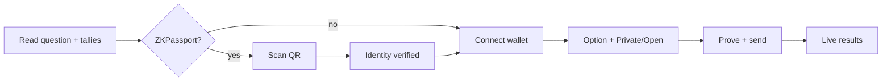

# 12 — UI / UX

Production: **https://aztec.happyvote.xyz**  
Brand: **HappyVote on Aztec**  
Code: `web/`

## Summary

Landing explains *why* the portal exists (privacy + verified personhood + safer participation). Vote pages match home width and separate **casting a ballot** from **reading live results**.

## Home (`/`)

Landing: brand, mission, pillars, **featured polls** (catalog `showOnHome`), trust, footer. The full catalog is **All polls** (`/polls`) — search, topic / country / eligibility filters.

Header: the logo returns home. From 900px up, the bar shows **All polls**, **Create**, **FAQ**, and a compact wallet control (**Connect**, or the short address and **Disconnect**). Below that width, the menu button holds the same links, the wallet, and a slot for later language / theme. There is no **Home** link. The vote page labels the network with its version (`testnet v6`). The footer repeats that version under the Aztec links.

### Content blocks

1. **Independent voting, without exposing who you are**
2. Pillars: Private by design · Verified, not doxed (ZKPassport) · Safer where votes are risky
3. **Featured polls** — operator-selected cards, then a link to the full catalog
4. **Why this matters** — independent of local gatekeepers; honest public tallies with protected voters

Author in the footer: Peter Ploskikh — [X](https://x.com/pittpv), [LinkedIn](https://www.linkedin.com/in/peter-ploskikh/), [GitHub](https://github.com/pittpv/).

## All polls (`/polls`)

Same cards as home, with search, filters (topic, country, eligibility), and sort (poll id, newest, ending soon) on one row on a wide screen. The first section is **Authoritative polls**. The next is **User polls**. Each of those has **Active**. **Ended** is one shared section after both, for every publisher. Polls still inside their catalog window, and polls that stay on the homepage, load with the page. **Ended** then shows 24 cards at a time from each publisher, with **Show more ended polls** for the next page. An account HappyVote has marked authoritative gets an **Authoritative** mark, and that account’s polls can sit in **Authoritative polls**. HappyVote’s own polls stay there without that mark.

## Create (`/create`)

Header link **Create**. The page has two tabs, **Create poll** and **Your polls**. **Connect Aztec wallet** opens the same dialog as voting. The form appears after an account connects. **Your polls** lists polls that address created and can end one that is still open. A browser session starts a new address each Connect. An installed wallet keeps the address, so reconnecting shows the same polls. The blocks are details, options, voting type, schedule, eligibility, and ballot fee. Each option has a label and an optional description. Privacy chips are voter choice, private only, or open only. Frequency chips are once per poll or once every 24 hours. The tally can stay sealed until close. Eligibility is any account, or ZKPassport personhood with optional age, birthdate, nationality, document, sanctions, and facematch checks. Those checks are signed with the listing. The server rejects a proof whose query is weaker than the signed rules. An end time is required, and the window is at most 90 days. One create per account per UTC day, and at most three of that account’s polls stay open. The creator does not choose homepage placement. Testnet can sponsor that one daily create transaction. Mainnet create pays the sender’s Fee Juice. The ballot fee is separate: Sponsored FPC on Testnet, the voter’s Fee Juice, or a poll pool.

**Ended** means voting is closed: the catalog `endsAt` is already in the past, or the chain has closed the poll (`vote_ended`, cancel, or on-chain `ends_at`). A poll with no end date stays under **Active** until that chain close. A poll that has not started yet also stays under **Active**. Search and filters apply to both groups. An ended card still opens; Connect and Vote on that page stay locked. The card word **Open** is open eligibility (no identity check), not a statement that voting is still running. Once the poll has ended, that eligibility word is left off the card and the status badge is **Ended**.

The **country** list includes ISO codes from catalog tags, self-served `nationalityIn` / `issuedBy`, and — when a poll uses a Dashboard `policyId` — `nationality` / `issuing_country` from that policy.

## Vote (`/p/:id`)

| Before | After |
|--------|--------|
| max 720px | `.app.app-wide` max **1080px** |
| Compact brand mark in the page | Site header + **← All polls** back to `/polls`; poll title as `h1` |
| Single stack | Ballot column + live-results column (≥860px) |
| Fees + how-to always visible | Collapsed `
` |
| No step hint | Ready/Verify → Connect → Vote. A finished step is green; **Vote** turns green after this browser records a ballot |

### Interaction

1. Guest: question, options, public tallies (`/api/poll-state`), plus schedule/countdown when dates are set. Catalog-only polls (not in the client seed) show **Loading poll…** until `GET /api/polls?id=` returns, then fetch tallies with the real option count. If the contract is paused or the poll is cancelled, Connect and Vote stay locked. Daily polls show a **Daily** catalog badge and a UTC-day countdown after a ballot. **Sealed** polls omit counts and fill bars on option buttons while voting is open; the header shows **Votes sealed**, and Live results explain that tallies stay hidden until close.
2. Optional ZKPassport gate (only while the voting window is open). The gate chunk loads after poll metadata so a mobile share link is not blocked by Dashboard or the QR widget.
3. Connect Aztec wallet. The modal always offers **Browser session** (initializerless PXE, new address each Connect), including on iPhone. Installed wallets that speak this network appear under the name they send. If an installed wallet is not listed, approve HappyVote in its popup and its name appears here. Several can be installed together. HappyVote shows the emoji grid for comparison. The connection continues only when the wallet confirms, and the HappyVote window then closes. The Labs Demo Wallet is not listed.
4. All polls lists current-contract ballots, then **Earlier networks** when a previous network still answers or a saved snapshot exists. The section is omitted when neither is available. A snapshot is taken while the old network can still be read, then shown after that network is gone. Rows show the network name, a collapsed contract address, and that network’s titles and results. Those rows do not open `/p/:id`.
5. Option + Private/Open → submit. The primary button says **Preparing wallet…** only until that address is registered once; later polls keep **Vote privately** / **Vote openly**. While a step is running (**Checking identity…**, **Preparing fee…**, **Proving ballot…**, **Waiting for block…**, **Updating results…**, **Preparing wallet…**), the button stays fully visible and three dots in the label bounce in turn. A local participation hint may appear if this browser already cast a ballot; it does not store an address and does not lock Vote. Submitting again with the **same account** fails on-chain.
6. The step description, success banner, and error sit directly under the button, above the privacy and daily-limit notes. **Open tx** is on that banner.

## ZKPassport gate

Portal chrome (teal / amber / Sora) wraps `@zkpassport/ui`. Duplicate widget title is hidden. **Try again** after a failed scan stays readable (opaque card `--zkp-bg`; the widget uses that variable as the retry label color). After success:

- QR is removed;
- compact **Identity verified** banner;
- details expand on click.

Desktop layout avoids large empty regions and awkward wrapping around the QR card. On small screens the connect CTA is not a huge sticky overlay that covers the ballot.

## Ballot privacy spacing

The **Ballot privacy** heading and the Private / Open controls have a clear gap so the fieldset does not look cramped.

## Schedule

Poll cards and vote pages show **Upcoming / Live / Ended** when `startsAt` / `endsAt` are set (catalog ISO; vote page prefers on-chain unix seconds). Cards also show **Ended** when `GET /api/poll-state?catalog=1` reports the poll closed, even if the catalog has no dates. Before start: countdown, Connect and Vote locked. After start: countdown to the end. Omit both dates for an always-open poll until `end_poll` or `cancel_poll`. On-chain pause also locks voting while guests can still read the question.

## Legal

Footer links on catalog, vote, and legal pages:

| Document | Path |
|----------|------|
| Terms of Service | `/legal/terms` |
| Privacy Policy | `/legal/privacy` |
| Data Safety | `/legal/data-safety` |
| Cookie Policy | `/legal/cookies` |
| GDPR | `/legal/gdpr` |

Effective date: **15 August 2026**. Contact: **legal@happyvote.xyz**. See [13-LEGAL.md](./13-LEGAL.md).

## SEO

Per-route `document.title`, meta description, canonical, Open Graph, Twitter card, and JSON-LD. Crawlers receive that head from `/api/document` before the app hydrates. Each poll page is unique: its own title, description, `og:*`, `twitter:*`, image URL (`/api/og?path=/p/:id`), and a `Question` with one suggested `Answer` per option. Home is `Organization` / `WebSite` / `WebApplication`. FAQ is an `FAQPage`. `robots.txt` allows indexing of public pages. `sitemap.xml` lists home, **All polls** `/polls`, **Create** `/create`, **FAQ** `/faq`, poll pages `/p/1`–`/p/5`, and legal URLs.

No third-party analytics counter on this subdomain. First-party cookieless daily aggregates only (`POST /api/site-stats`).

## Shipped 2026-08-13

- Sticky primary CTA on small screens (does not cover the ballot as a full-width wallet wall)
- Progress bars inside option buttons
- ZKPassport server re-verify + on-chain `identity_commitment`
- Portal-styled gate + collapse on success
- Brand rename to HappyVote on Aztec
- SEO

## Backlog (not shipped)

- Toast-style status instead of inline text
- Explicit confirm strip before Vote
- Empty-results CTA (“Be the first vote”)
- UI i18n RU/EN
