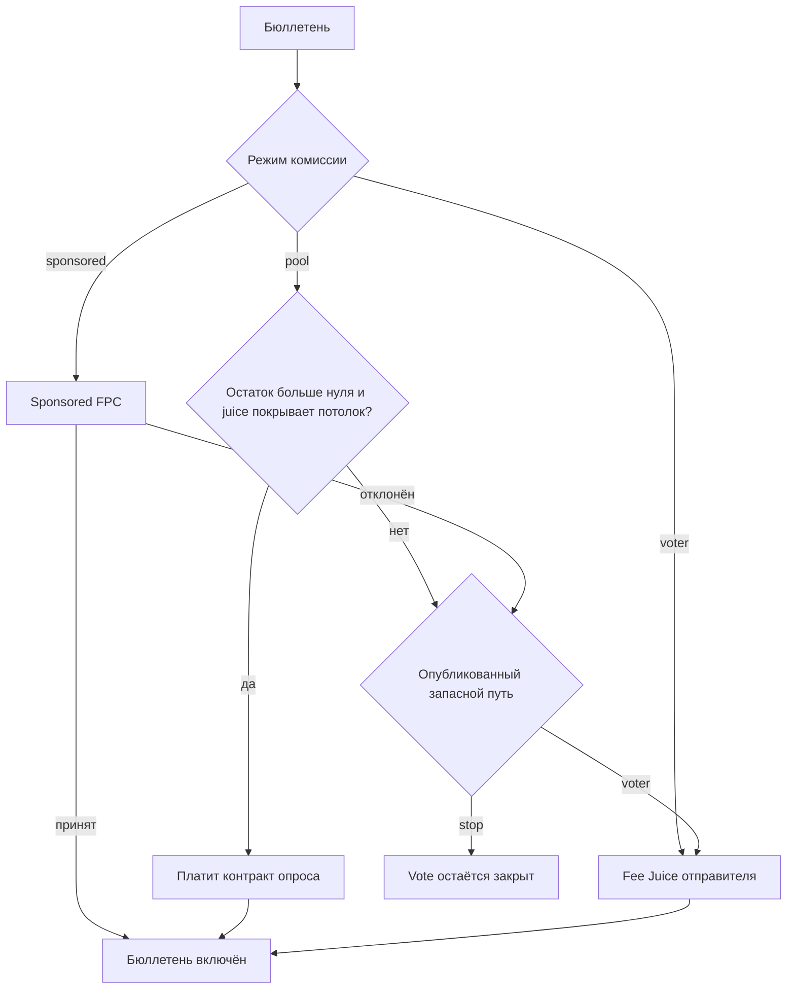

# 05 — План разработки

Toolchain: **Aztec Testnet 6.0.0**. Alpha — **6.0.0**.  
AI / CLI: https://docs.aztec.network/developers/ai_tooling

## Phase 0 — Foundation

**Готово (2026-08-11)** — Node 24.12, Aztec CLI 5.1.0, docs, каркас.

## Phase 1 — Контракты

**Готово** — Noir тесты + local smoke. Multi-poll `HappyVote`, private/open + `SingleUseClaim`, `create_poll` / `end_poll` / `cancel_poll` / pause / transfer, on-chain окно, truncation check.

## Phase 2 — Frontend MVP

**Готово** — https://aztec.happyvote.xyz. Vite React, Connect, guest tallies, сетка 1080px.

## Phase 3 — Testnet

**Задеплоено 2026-08-12**, актуальный контракт 2026-08-14. Адреса: [10-TESTNET-ADDRESSES.md](./10-TESTNET-ADDRESSES.md). Осталось: ручной private/open vote с внешнего аккаунта.

## Phase 4 — ZKPassport

**Live** — SDK + QR + server re-verify + `identity_commitment`. Осталось: E2E на устройстве.

## Phase 5 — Hardening

| # | Задача | Статус |
|---|--------|--------|
| 5.1 | Sealed tally | Готово |
| 5.2 | Метаданные + каталог | Готово — `/api/polls` |
| 5.3 | Юридические страницы | Готово |
| 5.4 | Security review | Готово |
| 5.5 | Client errors | Готово |
| 5.6 | Performance | Страница голоса: один `/api/poll-state`, регистрация контрактов один раз на адрес, одна симуляция перед prove внутри `send` |
| 5.7 | Production + SEO | Готово |
| 5.8 | Mobile CTA + option bars | Готово |
| 5.9 | ZKPassport в стиле портала | Готово |
| 5.10 | Окно голосования | Готово — on-chain `starts_at` / `ends_at` + ISO в каталоге + обратный отсчёт |
| 5.11 | Hardening контракта | Готово — PublicImmutable конфиг, проверки до nullifier, pause, cancel, transfer_admin, next_poll_id |
| 5.12 | Свои агрегаты посещений | Готово — cookieless `POST /api/site-stats`, чтение оператором |
| 5.13 | Initializerless Browser session | Готово — `createSchnorrInitializerlessAccount`; без tx деплоя аккаунта |

## Phase 6 — Образ основной сети

**Статус: образ сети уже в проде (2026-10-30).** Стабильный Aztec **6.0.0** — образ и Testnet, и Mainnet (Alpha).

| Сеть | RPC |
|------|-----|
| Testnet | `https://aztec-testnet.drpc.org` |
| Mainnet | `https://aztec-mainnet.drpc.org` |

HappyVote на https://aztec.happyvote.xyz по-прежнему принимает бюллетени в **Testnet**. Выкладка этого контракта в Mainnet — отдельная работа: Fee Juice или FPC, новый адрес контракта и постоянный кошелёк как основной Connect, когда он говорит на 6.0.0. Browser session может остаться лёгким входом. Demo Wallet Labs в списке Connect нет.

## Итерация 2 — опросы пользователей

**Статус: не начата.** Итерация 1 по-прежнему публикуется операторами. Ниже план реализации.

### Результат

Подключённый Aztec-аккаунт может опубликовать опрос. Голосующие находят его в All polls. Контракт по-прежнему даёт один бюллетень на аккаунт (или на сутки UTC) и публичный tally — либо sealed до закрытия. Главная остаётся отобранным списком.

### Что уже есть

`create_poll` доступен только admin. Он хранит число вариантов, политику приватности, eligibility, `metadata_hash`, флаг sealed, окно и частоту голоса. Названия и подписи вариантов живут в каталоге и связаны этим хешем. `end_poll`, `cancel_poll` и pause остаются у admin контракта. `MAX_OPTIONS` — 32. Нужно не меньше двух вариантов.

### Контракт

Отдельный public-вход, который может вызвать любой аккаунт. Admin-`create_poll` остаётся для опросов, которые публикует HappyVote.

Новый вход закрывается при ошибке:

- Вызывающий записывается как создатель опроса.
- `options_count` от 2 до 32.
- Приватность и eligibility — только уже принятые контрактом значения.
- `metadata_hash` не ноль.
- `ends_at` обязателен, в будущем и не позже чем через 90 дней после `starts_at` (или после времени блока, если `starts_at` равен 0).
- Контракт не на паузе.
- Id берётся из `next_poll_id`. Вызывающий не выбирает id и не может перезаписать существующий опрос.
- Один nullifier создания на аккаунт в сутки UTC и не больше трёх ещё открытых опросов этого создателя.
- Создатель может вызвать `end_poll` только у своего опроса. `cancel_poll` и pause остаются только у admin.

Noir-тесты: создание не-admin, отказ при перезаписи, отказ без даты конца, отказ на паузе, отказ на четвёртом открытом опросе, создатель закрывает, посторонний не закрывает, admin по-прежнему может отменить.

### Каталог

Цепочка не хранит названия. После включения транзакции создатель публикует подписи в каталог подписью того же адреса, который отправил транзакцию. Сервер проверяет подпись и то, что `metadata_hash` совпадает с каноническим JSON названия, описания и подписей вариантов. Запись без подписи или с другим хешем в список не попадает.

Флаги главной создатель не ставит. Новый опрос виден только в All polls.

### Антиспам

- Суточный лимит создания и лимит открытых опросов на контракте.
- Каталог отвергает пустое название, подпись длиннее 80 символов, описание длиннее 280 и больше восьми тем.
- На Testnet первое создание опроса аккаунтом за сутки UTC может идти через Sponsored FPC. Следующие создания в эти сутки платит Fee Juice создателя. На Mainnet создание опроса всегда платит Fee Juice создателя.
- Нет публикации, если хеш или подпись не совпали.

### Комиссия бюллетеня

Голос — одна транзакция Aztec: `cast_vote_private` или `cast_vote_open` плюс вызов оплаты комиссии. Второй платы HappyVote в этой транзакции нет. Опрос при создании записывает режим комиссии и запасной путь. Потом они не меняются без нового опроса.

| Режим | Кто платит комиссию сети | Где доступен |
|-------|--------------------------|--------------|
| `sponsored` | Публичный Sponsored FPC Aztec, `sponsor_unconditionally` | Только Testnet. На Mainnet создание с этим режимом отклоняется. |
| `voter` | Fee Juice аккаунта, который отправляет бюллетень | Testnet и Mainnet. На Mainnet это значение по умолчанию. |
| `pool` | Контракт оплаты, привязанный к этому опросу, пока публичный остаток больше нуля и Fee Juice контракта покрывает потолок комиссии | Testnet и Mainnet. Необязателен. |

Запасной путь выбирается при создании и виден на опросе до первого голоса: `stop` блокирует Vote, либо `voter` — следующие бюллетени платит Fee Juice отправителя. Отказ спонсорства сам режим не переключает.

Потолок комиссии тот же, что уже на Testnet: `maxFeesPerGas` — два последних блока, чтобы долгое prove не проиграло гонку base fee. Контракт оплаты не кладётся в `additionalScopes`. `sponsor_unconditionally` только называет плательщика и не читает его приватные заметки.

**Testnet.** Для нового опроса по умолчанию `sponsored`, тот же публичный Sponsored FPC, что у сегодняшних бюллетеней (`0x2d8fff82a3b0c15d0a89169e7d8d043e079ab94d52031f1de1e4972ebad169d3`). Страница говорит, что комиссию сети покрывает спонсор. Если этот FPC отклоняет транзакцию, Vote остаётся закрыт, кроме случая, когда опубликованный запасной путь этого опроса — `voter`: тогда страница прямо говорит, что аккаунт заплатит Fee Juice, и отправитель подтверждает этот путь. `voter` и `pool` на Testnet можно выбрать, чтобы репетировать путь Mainnet. Пока Sponsored FPC доступен, пул не обязателен.

**Mainnet.** Общего Sponsored FPC, на который можно опереться по умолчанию, нет. Создание отклоняет `sponsored`. По умолчанию `voter`: кнопка до начала prove говорит, что аккаунт платит Fee Juice. Второй режим — `pool`. Создатель пополняет его отдельной транзакцией со своего Fee Juice. Она увеличивает публичный остаток и переводит Fee Juice в контракт оплаты опроса. Каждый включённый спонсируемый бюллетень уменьшает остаток на один. Если остаток ещё больше нуля, но juice не покрывает текущий потолок, спонсорство не проходит и срабатывает опубликованный запасной путь. После `end_poll` или `cancel_poll` неиспользованный Fee Juice возвращается создателю. HappyVote его не оставляет себе.

Пул опроса не оплачивает создание самого опроса. На Testnet первое создание аккаунтом за сутки UTC может идти через Sponsored FPC, дальнейшие в эти сутки — через Fee Juice. На Mainnet каждое создание платит Fee Juice создателя.

Страница голоса называет действующий режим до Connect: спонсор сети, ваш Fee Juice или покрытие этим опросом и оставшееся число. Гость читает эту строку без кошелька.

### Модерация

- Admin `cancel_poll` по-прежнему останавливает голосование. Tally остаётся публичным.
- Флаг скрытия в каталоге убирает опрос из All polls и с главной. Строка в контракте не удаляется. `/p/:id` открывается и прямо говорит, что карточку скрыли.
- Жалобы — следующий срез этой итерации: подписанная жалоба вне цепи, затем скрытие или отмена. Отдельного голосования по жалобе в этой итерации нет.

### Находка

All polls уже ищет по названию, теме, стране и eligibility и делит Active и Ended. Добавить сортировку: новые и те, что скоро закроются. До неё порядок — по id. Опросы пользователей и операторов живут в одних и тех же Active / Ended.

### Страница создания

Публичная страница, ссылка в шапке появится вместе с этой итерацией:

- Название, описание, 2–32 варианта, темы.
- Приватность: выбор голосующего (по умолчанию), только private или только open.
- Eligibility: open или personhood ZKPassport.
- Sealed tally.
- Старт и обязательный конец в пределах 90 дней.
- Один раз на опрос или один раз в сутки UTC.
- Режим комиссии. На Testnet по умолчанию Sponsored FPC. На Mainnet по умолчанию Fee Juice голосующего. Пул опроса необязателен. Страница показывает режим и запасной путь до публикации.
- Connect, prove, затем подпись каталога.
- Превью — та же карточка, что в All polls.
- Текст прямо говорит: private скрывает адрес, tally публичен, если опрос не sealed.

Это не экран оператора.

### Шаблоны

Binary (2 варианта) и single choice (3–32) — то, что контракт уже умеет. Yes/no или шкала 1–5 — пресеты этих двух, не новая схема подсчёта.

### Terms

До публичной страницы создания в Terms — короткий пункт про материалы пользователей: за вопрос отвечает создатель, HappyVote может скрыть карточку и остановить голосование, запись в контракте не стирается. Дисклеймер остаётся: это не избирательная комиссия.

### Порядок

| Шаг | Выход |
|-----|--------|
| 2.1 Контракт и Noir-тесты | Создание не-admin, лимиты выше и режим комиссии проходят `aztec test`. Конфиг Mainnet отклоняет `sponsored`. Пул платит, пока остаток больше нуля и juice покрывает потолок. На нуле работает только запасной путь, выбранный при создании. Остаток juice возвращается создателю. |
| 2.2 Подпись каталога | Создание с верным хешем попадает в список. Чужой хеш — нет |
| 2.3 Страница создания | Аккаунт, который не admin контракта, публикует опрос и открывает его из All polls |
| 2.4 Модерация | Скрытие убирает карточку. Отмена останавливает голосование. Ссылка по-прежнему объясняет опрос |
| 2.5 Сортировка и terms | «Новые» и «скоро закроются» работают, пункт terms на сайте |

### Вне scope

Адаптеры DAO, казны, мультисига и рынков прогнозов — Итерация 3. Также вне scope: ranked choice, делегирование, цена HappyVote на кнопке Vote и перевод интерфейса. Комиссия сети в разделе выше — это комиссия транзакции Aztec, не цена HappyVote.

## Итерация 3 — адаптеры координации

**Статус: не начата.** Короткий набросок. Источник: [HappyVote on Aztec, 2 октября 2026](https://x.com/happyvoteaztec/status/2105979258011050065). Это места для того же примитива, не кнопки на сайте.

Уже есть: приватный бюллетень (адрес скрыт), nullifier (`SingleUseClaim`), публичный tally или tally, скрытый до закрытия, и по желанию personhood ZKPassport. Третья сторона бюллетени не хранит.

| Среда | К чему примитив |
|-------|-----------------|
| DAO | Набор допущенных плюс nullifier и публичный tally без имени голосующего. Personhood, когда важна устойчивость к Sybil. Open eligibility, когда участники — уже сами аккаунты. |
| Казна | Приватный голос и проверяемый итог, sealed до закрытия предложения: сигнал про предложение, а не публичный список лояльности. |
| Мультисиг | Приватная проверка среди подписантов до исполнения. Исполняет по-прежнему мультисиг. Позиция каждого не рассылается. |
| Рынки прогнозов | Приватное суждение о разрешении или споре, публичный исход, без хранителя голосов. |

Первый срез: один интерфейс чтения (id опроса, кто может голосовать, как вызывающий читает tally) и одна страница заметок на каждую среду. Экранов DAO, казны, мультисига и рынка нет, пока кто-то не принесёт конкретную форму. Ни одна из четырёх сред сейчас не подключена.

## DoD итерации 1

Контракты на Testnet, UI на домене, четыре демо-опроса (включая sealed), private/open, double-vote невозможен (опционально раз в сутки UTC), ZKPassport gate, тесты, гайд. Не закрыто: E2E на устройстве.
