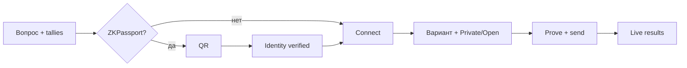

# 12 — UI / UX

Production: **https://aztec.happyvote.xyz**  
Бренд: **HappyVote on Aztec**

## Кратко

Лендинг объясняет *зачем* портал. Страница голосования той же ширины: бюллетень отдельно от live results.

## Главная (`/`)

Лендинг: бренд, миссия, pillars, **featured polls** (поле каталога `showOnHome`), блок доверия, подвал. Полный каталог — **All polls** (`/polls`) с поиском и фильтрами.

Шапка: логотип ведёт на главную. От 900px в строке **All polls**, **Create**, **FAQ** и компактный кошелёк (**Connect** либо короткий адрес и **Disconnect**). Ниже этой ширины кнопка меню открывает те же ссылки, кошелёк и место под язык / тему позже. Ссылки **Home** нет. На странице голоса у Network стоит версия (`testnet v6`). В подвале та же версия — справа под ссылками на Aztec.

Pillars: Private by design · Verified, not doxed · Safer where votes are risky.

## Все опросы (`/polls`)

Та же сетка карточек, что на главной, плюс поиск, фильтры (тема, страна, eligibility) и сортировка (id, новые, скоро закроются) в одну строку на широком экране. Первая секция — **Authoritative polls**. Следующая — **User polls**. В каждой из них есть **Active**. **Ended** — одна общая секция после обеих, для всех издателей. Опросы, у которых окно ещё не кончилось, и опросы, которые остаются на главной, приходят вместе со страницей. В **Ended** сначала по 24 карточки от каждого издателя, дальше кнопка **Show more ended polls**. Аккаунт, который HappyVote отметил как авторитетный, получает бейдж **Authoritative**, и его опросы могут стоять в **Authoritative polls**. Опросы самого HappyVote остаются там без этого бейджа.

## Создание (`/create`)

Пункт шапки **Create**. На странице две вкладки: **Create poll** и **Your polls**. **Connect Aztec wallet** открывает тот же диалог, что и голосование. Форма появляется после подключения аккаунта. **Your polls** показывает публичные опросы этого адреса сразу, как они загрузились, затем приватные опросы этого кошелька, и может закрыть ещё открытый. Browser session при каждом Connect получает новый адрес. Установленный кошелёк хранит адрес, поэтому повторное подключение показывает те же опросы. Блоки: детали, варианты, тип голосования, расписание, eligibility и плата за бюллетень. У каждого варианта есть подпись и необязательное описание. Чипы приватности: выбор голосующего, только закрытый или только открытый голос. Чипы частоты: один раз на опрос или раз в 24 часа. Вариант можно оставить приватной заметкой до публикации счётчиков после закрытия. Eligibility: любой аккаунт или ZKPassport personhood с необязательными проверками возраста, даты рождения, национальности, документа, sanctions и facematch. Проверки входят в подпись объявления. Сервер отклоняет доказательство, если его запрос слабее подписанных правил. Дата окончания обязательна, окно не длиннее 90 дней. Один аккаунт создаёт один опрос в сутки UTC и держит не больше трёх открытых. Место на главной выбирает HappyVote. На Testnet эту одну дневную транзакцию создания может оплатить Sponsored FPC. На Mainnet создание платит Fee Juice отправителя. Плата за бюллетень отдельно: Sponsored FPC на Testnet, Fee Juice голосующего или пул опроса.

**Ended** — голосование закрыто: в каталоге уже прошла `endsAt`, либо цепь закрыла опрос (`vote_ended`, cancel или on-chain `ends_at`). Без даты окончания опрос остаётся в **Active**, пока его не закроют на цепи. Ещё не начавшийся опрос тоже в **Active**. Поиск и фильтры действуют на обе группы. Карточка завершённого опроса открывается; Connect и Vote на странице остаются закрыты. Слово **Open** на карточке — это open eligibility (без проверки личности), а не признак, что голосование ещё идёт. После завершения это слово с карточки убирается, остаётся бейдж **Ended**.

Список **стран** берёт ISO-коды из тегов каталога, self-served `nationalityIn` / `issuedBy` и — если у опроса есть Dashboard `policyId` — из `nationality` / `issuing_country` этой политики.

## Голосование (`/p/:id`)

Ширина **1080px**. Общая шапка сайта, ссылка **← All polls** на `/polls`, вопрос — `h1`. Две колонки на десктопе. Комиссии и how-to в `
`. Чипы Ready/Verify → Connect → Vote: пройденный шаг зелёный, **Vote** зеленеет после записанного в этом браузере бюллетеня. На дневных опросах бейдж **Daily** и отсчёт до следующих суток UTC. На опросе **sealed** на кнопках вариантов нет счётчиков и полосок. В шапке **Votes sealed**. Пока нет принятых бюллетеней, Live results сообщают, что опрос sealed и результаты будут доступны после завершения голосования. После принятия бюллетеней Live results показывают их число. Счётчики вариантов появляются после публикации получателем итога. Чипов Private/Open нет: вариант — приватная заметка.

Опросы только из overlay (не из клиентского seed) показывают **Loading poll…**, пока не придёт `GET /api/polls?id=`; tallies читаются уже с верным числом вариантов. ZKPassport-гейт подгружается после метаданных, чтобы шаринговая ссылка на телефоне не ждала Dashboard и QR.

Модалка всегда предлагает **Browser session** (initializerless, новый адрес на подключение), в том числе на iPhone. Установленные кошельки, которые говорят на этой сети, показываются под своим именем. Если установленный кошелёк не в списке, одобрите HappyVote в его всплывающем окне — имя появится здесь. Кошельков может быть несколько сразу. HappyVote показывает сетку эмодзи для сверки. Подключение продолжается только после подтверждения в кошельке, и окно HappyVote тогда закрывается. Demo Wallet Labs в списке нет. All polls после текущих опросов показывает **Earlier networks** только если прошлая сеть ещё читается или есть сохранённый снимок: прошлая сеть, свёрнутый адрес контракта, названия и результаты. Эти строки не открывают `/p/:id`. Кнопка показывает **Preparing wallet…** только пока адрес регистрируется первый раз; следующие опросы сразу **Vote privately** / **Vote openly**. Пока идёт шаг (**Checking identity…**, **Preparing fee…**, **Proving ballot…**, **Waiting for block…**, **Updating results…**, **Preparing wallet…**), кнопка остаётся яркой, а три точки в подписи по очереди подпрыгивают. Описание шага, плашка успеха и ошибка стоят сразу под кнопкой, выше заметок про privacy и дневной лимит. **Open tx** — на этой плашке. Prove голоса по-прежнему может быть долгим. После смены разрешений кошелька — отключиться и подключиться снова. Если с этого браузера уже голосовали, UI показывает локальную подсказку (без адреса) и **не** блокирует Vote: повтор с тем же аккаунтом упадёт ончейн.

## ZKPassport

Обёртка в стиле портала. После неудачного скана **Try again** остаётся читаемым. После успеха — баннер **Identity verified**. На мобильных Connect не перекрывает бюллетень огромным sticky-слоем.

## Ballot privacy

Зазор между заголовком **Ballot privacy** и кнопками Private / Open.

## Расписание

Карточки и страница опроса показывают **Upcoming / Live / Ended**, если заданы `startsAt` / `endsAt` (ISO в каталоге; страница голоса предпочитает on-chain unix-секунды). Карточка также показывает **Ended**, если `GET /api/poll-state?catalog=1` сообщает, что опрос закрыт, даже без дат в каталоге. До старта — обратный отсчёт, Connect и Vote закрыты. После старта — отсчёт до конца. Без дат опрос открыт, пока его не закроют `end_poll` / `cancel_poll`. Пауза контракта тоже блокирует голос; вопрос остаётся читаемым.

## Legal

| Документ | Путь |
|----------|------|
| Terms of Service | `/legal/terms` |
| Privacy Policy | `/legal/privacy` |
| Data Safety | `/legal/data-safety` |
| Cookie Policy | `/legal/cookies` |
| GDPR | `/legal/gdpr` |

Дата: **15 August 2026**. Контакт: **legal@happyvote.xyz**. [13-LEGAL.md](./13-LEGAL.md).

## FAQ (`/faq`)

Три группы, внутри каждой более важный вопрос стоит выше: **For voters**, **For creators**, **General**. Для голосующих: приватность, открытый или скрытый до закрытия итог, как голосовать, лимит один раз на аккаунт или на сутки UTC, плата за бюллетень, которую задал опрос, кошельки, ZKPassport и sealed. Для создающих: публикация, ход создания, правила формы, место в All polls, дневной лимит и три открытых опроса, **Your polls** и раннее закрытие, правила, которые остаются как при создании, плата за создание и за бюллетень, опрос уже в цепи до появления заголовка. Общие: что это за сайт, что это не избирательная комиссия, сеть, Authoritative и User polls, прошлые сети. Страница — `FAQPage`. Ссылки сверху ведут к группе.

## SEO

Title, description, canonical, OG, Twitter, JSON-LD. Краулеры получают head из `/api/document` до гидрации. У каждого опроса свои title, description, `og:*`, `twitter:*`, URL картинки (`/api/og?path=/p/:id`) и схема `Question` с `Answer` на каждый вариант. FAQ — `FAQPage`. `robots.txt`, `sitemap.xml` (включая `/faq`, `/polls` и `/p/1`–`/p/5`). Стороннего счётчика нет. Есть свои cookieless дневные агрегаты (`POST /api/site-stats`).
